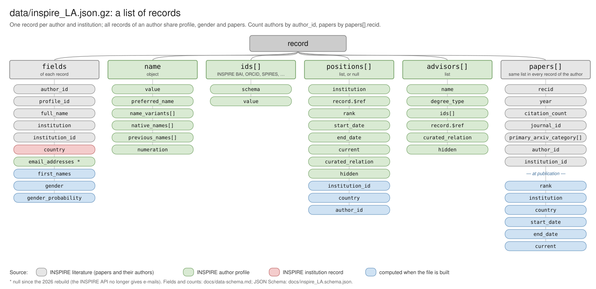

# inspireauth
[](https://doi.org/10.5281/zenodo.23868569)

INSPIRE-HEP author records for Latin America, and the code used to build them.

## The dataset: `data/inspire_LA.json.gz`

[`data/inspire_LA.json.gz`](./data/inspire_LA.json.gz) is the full dataset: a single gzipped JSON file (21 MB; 333 MB uncompressed) with **73,118 records of 36,570 distinct authors** in High Energy Physics, Cosmology and Astroparticle Physics with affiliations to Latin American institutions in [INSPIRE-HEP](https://inspirehep.net), and 60,538 distinct papers, downloaded on 2026-11-03 (papers up to 2026).

The paper *Statistical Analysis of Scientific Metrics in High Energy, Cosmology, and Astroparticle Physics in Latin America* (M. Morales-Alvarado, F. Quevedo, M. Ramos-Hamud, D. Restrepo) used the earlier version, with 57,588 records of 29,979 authors and 49,181 papers up to 2022: it is in the [Zenodo release](https://doi.org/10.5281/zenodo.23868569) and in the git tag `v1.0.1` of this repository.

It is an ordinary git file (no Git LFS needed). The paper's version, `data/inspire_LA.json` at tag `v1.0.1`, is stored with [Git LFS](https://git-lfs.com): check it out with `git-lfs` installed, or download it from [Zenodo](https://doi.org/10.5281/zenodo.23868569).

```python
import gzip, json
with gzip.open('data/inspire_LA.json.gz', 'rt', encoding='utf-8') as f:
    authors = json.load(f)          # list of 73,118 dicts
```

or `pandas.read_json('data/inspire_LA.json.gz')`; `gunzip -k data/inspire_LA.json.gz` gives the plain JSON.

### How the records were built

For each Latin American country, the institutions of that country were taken from INSPIRE-HEP, and for each institution its papers with at most 10 authors. Every author of those papers became a record. Authors are then extended with their INSPIRE profile (positions, advisors, e-mails, identifiers), each paper gets the rank and affiliation the author held when it was published ([students.ipynb](students.ipynb)), and gender is inferred from the first names and the country of the affiliation ([gender.ipynb](gender.ipynb), [gender-genderize.ipynb](gender-genderize.ipynb)). The construction code is in [INSPIREHEP.ipynb](INSPIREHEP.ipynb); [build/build_inspire_LA.py](build/build_inspire_LA.py) follows the same rules in one script (cached, batched requests; gender with [genderize-offline](https://pypi.org/project/genderize-offline/)) and built the current file: `python build/build_inspire_LA.py` (writes `data/inspire_LA.json.gz`; the same data give the same bytes).



**There is one record per author and institution.** An author with several institutions in INSPIRE (current or past, in Latin America or elsewhere) appears once for each of them, and every one of those records carries the author's whole list of papers. Deduplicate by `author_id` to count authors, and by `papers[].recid` to count papers.

### Record fields

| Field | Type | Description |
|---|---|---|
| `author_id` | string | INSPIRE BAI of the author, e.g. `D.Restrepo.1`. Unique per author. |
| `profile_id` | string, null or absent | INSPIRE author record number (`https://inspirehep.net/api/authors/<profile_id>`); null or absent if the author has no profile. |
| `full_name` | string | Name as written in the papers, `"Family, Given"`. |
| `first_names` | string | Given names used for gender inference (initials removed); empty if only initials are known. |
| `name` | object or null | Name block of the INSPIRE profile: `value`, `preferred_name`, `name_variants`, `native_names`, `previous_names`, `numeration`. |
| `ids` | list or null | Identifiers from the profile, `{schema, value}` with schema such as `INSPIRE BAI`, `INSPIRE ID`, `ORCID`, `SPIRES`, `DESY`. |
| `email_addresses` | list or null | `{value, current, hidden}`. Null since the 2026 rebuild: the INSPIRE API no longer gives e-mails publicly. |
| `institution` | string | INSPIRE short name of the institution of this record, e.g. `Antioquia U.` |
| `institution_id` | string | INSPIRE institution record number (`https://inspirehep.net/api/institutions/<institution_id>`). |
| `country` | string | Country of `institution`. Not necessarily Latin American (see above). |
| `gender` | string | `male`, `female` or `unknown`, inferred with [genderize-offline](https://pypi.org/project/genderize-offline/) (World Gender Name Dictionary 2.0) from `first_names` and the `country` of the author's first record (genderize.io before the 2026 rebuild). |
| `gender_probability` | float | Probability of `gender` (0.5–1; 0 for `unknown`). The paper treats values below 0.9 as unknown, which leaves 23,564 authors with a gender (18,017 in the paper's version). |
| `positions` | list or null | Positions from the INSPIRE profile (see below). |
| `advisors` | list | Thesis advisors from the profile, `{name, degree_type, ids, record, curated_relation, hidden}`; `degree_type` is `phd`, `master` or `other`. |
| `papers` | list | Papers of the author (see below). |

### `positions[]`

| Field | Description |
|---|---|
| `institution`, `institution_id`, `record.$ref` | Institution of the position. |
| `country` | Country of that institution. |
| `rank` | `UNDERGRADUATE`, `MASTER`, `PHD`, `POSTDOC`, `JUNIOR`, `SENIOR`, `STAFF`, `VISITOR`, `OTHER`, or absent. |
| `start_date`, `end_date` | Years, as strings; may be absent. |
| `current` | Whether it is the current position. |
| `author_id` | Copy of the record's `author_id`. |
| `curated_relation`, `hidden` | INSPIRE flags. |

### `papers[]`

| Field | Description |
|---|---|
| `recid` | INSPIRE literature record number (`https://inspirehep.net/api/literature/<recid>`). |
| `year` | Publication year, as a string. |
| `citation_count` | Citations in INSPIRE when the data were downloaded. |
| `journal_id` | INSPIRE journal record number, or the string `"None"` if not published in a journal. |
| `primary_arxiv_category` | List with the arXiv category, e.g. `["hep-ph"]`; empty if not on arXiv. |
| `author_id` | The author's BAI in this paper. |
| `institution_id` | Affiliation of the author in this paper. |
| `institution`, `country`, `rank`, `start_date`, `end_date`, `current` | Present when the affiliation matches a position of the author's profile: the position (and its rank) the author held when the paper was published. |

### Example record (abridged)

```json
{
  "author_id": "D.Restrepo.1",
  "profile_id": "991924",
  "full_name": "Restrepo, Diego",
  "first_names": "Diego Alejandro",
  "institution": "Antioquia U.",
  "institution_id": "903906",
  "country": "Colombia",
  "gender": "male",
  "gender_probability": 0.99,
  "ids": [{"schema": "ORCID", "value": "0000-0001-6455-5564"}],
  "positions": [{"institution": "Antioquia U.", "institution_id": "903906", "country": "Colombia",
                 "rank": "SENIOR", "start_date": "2004", "current": true}],
  "advisors": [{"name": "Valle, Jose W.F.", "degree_type": "phd",
                "ids": [{"schema": "INSPIRE ID", "value": "INSPIRE-00133260"}],
                "record": {"$ref": "https://inspirehep.net/api/authors/985058"}}],
  "papers": [{"recid": 926166, "year": "2012", "citation_count": 46,
              "primary_arxiv_category": ["hep-ph"], "journal_id": "None",
              "author_id": "D.Restrepo.1", "institution_id": "903906",
              "institution": "Antioquia U.", "country": "Colombia", "rank": "SENIOR",
              "start_date": "2004", "end_date": null, "current": true}]
}
```

## Other files

| File | Content |
|---|---|
| `data/inspire_institutions.json` | INSPIRE-HEP institutions. |
| `data/inspire_dois.json`, `data/recids.json` | DOIs and INSPIRE record numbers of the papers, used for the OpenAlex comparison. |
| `data/only_inspire_in_OpenAlex.json.gz`, `data/only_openalex.json`, `data/openalex_topics.json.gz` | Comparison with OpenAlex ([openalex-topics.ipynb](openalex-topics.ipynb)). |
| `data/genderize.csv`, `data/test_gender.csv` | Input and test data of the gender inference. |
| `data/cinvestav.csv`, `data/work.json` | Example and test data. |

## Citation

Cite the dataset with its DOI, [10.5281/zenodo.23868569](https://doi.org/10.5281/zenodo.23868569); see [CITATION.cff](CITATION.cff). License: CC0-1.0.

## Maintenance: delete older versions of the dataset
To delete older versions of a file in your repository, you need to remove or clean up the history where those versions exist. Here are the steps you can follow:

1. **Identify the Commits**: Find the commits where the older versions of the file exist.
2. **Rebase or Filter the History**: Use tools like `git rebase` or `git filter-repo` to edit the history and remove the older versions of the file.
3. **Force Push**: After editing the history, you will need to force push the changes to the remote repository.

Here is an example using `git filter-repo`:

1. Install `git-filter-repo` if you haven't already:

   ```sh
   pip install git-filter-repo
   ```

2. Run the following command to remove the file from the history:

   ```sh
   git filter-repo --path data/inspire_LA.json --invert-paths
   ```

3. Force push the changes:

   ```sh
   git push origin --force
   ```

Please note that rewriting history can have significant effects, especially if others are working on the same repository. Ensure you coordinate with your team and understand the implications before proceeding.
