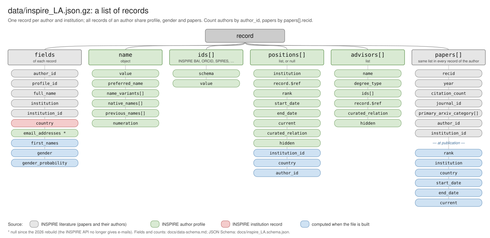

# Data schema of `data/inspire_LA.json`

`data/inspire_LA.json.gz` is the main dataset of this repository: INSPIRE-HEP author records for Latin
America in high-energy physics, cosmology and astroparticle physics. This page describes every field.
A machine-readable version is [`inspire_LA.schema.json`](inspire_LA.schema.json) (JSON Schema 2020-12),
and `python docs/validate_schema.py [file]` checks a file against it (it needs `pip install jsonschema`).



## Versions

| Version | File | Records | Authors | Papers | Notes |
|---|---|---|---|---|---|
| Paper's data, up to 2022 (tag `v1.0.1`, [Zenodo](https://doi.org/10.5281/zenodo.23868569)) | `data/inspire_LA.json` (Git LFS, 230 MB) | 57,588 | 29,979 | 49,181 | genders from genderize.io; e-mails present; `profile_id` null or absent without a profile |
| 2026 rebuild (2026-11-03, on `main`) | `data/inspire_LA.json.gz` (21 MB; 333 MB uncompressed) | 73,118 | 36,570 | 60,538 | genders from genderize-offline; `email_addresses` always null |

Both versions follow this schema. The rebuild comes from [`build/build_inspire_LA.py`](../build/build_inspire_LA.py).

```python
import gzip, json
with gzip.open('data/inspire_LA.json.gz', 'rt', encoding='utf-8') as f:
    records = json.load(f)          # a list of dicts, one per author and institution
```

## The unit: one record per author and institution

The file is a JSON list. It was built like this:

1. For each Latin American country, the INSPIRE-HEP institutions of that country were found, and then
   each institution's papers with at most 10 authors.
2. Every author of those papers became a record for each of their affiliations in those papers.

So **an author appears once for each institution** they were affiliated with, whether current or
past, and whether in Latin America or elsewhere.

All the records of an author share:
- the **profile fields** (`profile_id`, `name`, `ids`, `positions`, `advisors`);
- **gender**;
- **the whole list of papers** (`papers`).

What differs between them is `institution`, `institution_id`, `country`, and the `full_name` as written in the paper that created the record.

- To count authors, deduplicate by `author_id`.
- To count papers, deduplicate by `papers[].recid`.
- A country's papers are those whose `papers[].institution_id` belongs to one of the country's records
  ([`reproduce/README.md`](../reproduce/README.md) gives the counting rules of the paper).

Field colours in the diagram show where each value comes from:

| Colour | Source |
|---|---|
| grey | INSPIRE-HEP literature records (the papers and their author lists) |
| green | the author's INSPIRE-HEP profile (`/api/authors`) |
| red | INSPIRE-HEP institution records |
| blue | computed when the file is built |

## Record

"Present" counts how many of the 73,118 records of the 2026 rebuild have the field with a non-null value.

| Field | Type | Present | Description |
|---|---|---|---|
| `author_id` | string | 73,118 | INSPIRE BAI of the author, e.g. `D.Restrepo.1`; the same in all records of an author. Authors without a BAI get `unknown00`, `unknown01`, … (one per full name). |
| `profile_id` | string, null | 73,118 | INSPIRE author record number: `https://inspirehep.net/api/authors/<profile_id>`. Null or absent in the paper's version when the author has no profile. |
| `full_name` | string | 73,118 | Name as written in the paper that created this record, `"Family, Given"`. |
| `first_names` | string | 73,118 | Given names used for the gender inference, from `name.value` (else `full_name`), with initials removed; empty when only initials are known. One per author. |
| `name` | object, null | 73,118 | Name block of the INSPIRE profile (below). |
| `ids` | list, null | 73,118 | Identifiers of the profile, `{schema, value}` (below). |
| `email_addresses` | list, null | 0 | E-mails of the profile, `{value, current, hidden}`. Null since the 2026 rebuild: the INSPIRE API no longer gives them. |
| `institution` | string | 73,118 | INSPIRE short name of the institution of this record, e.g. `Antioquia U.` |
| `institution_id` | string, null | 73,064 | INSPIRE institution record number: `https://inspirehep.net/api/institutions/<institution_id>`. |
| `country` | string, null | 72,867 | Country of the institution (its first address in INSPIRE), e.g. `Colombia`, `Russian Federation`. Not necessarily Latin American. |
| `gender` | string | 73,118 | `male`, `female` or `unknown`, inferred from `first_names` and the `country` of the author's first record. The 2026 rebuild uses [genderize-offline](https://pypi.org/project/genderize-offline/) (World Gender Name Dictionary 2.0); the paper's version used genderize.io. |
| `gender_probability` | number | 73,118 | Probability of `gender`: 0.5–1, and 0 for `unknown`. The analyses count a gender only at 0.9 or more (23,564 authors in the rebuild, 18,017 in the paper's version). |
| `positions` | list, null | 38,208 | Positions of the INSPIRE profile (below); null if there are none. |
| `advisors` | list | 73,118 | Thesis advisors of the profile (below); empty if there are none. |
| `papers` | list | 73,118 | The author's papers with at most 10 authors (below). |

### `name`

| Field | Type | Present | Description |
|---|---|---|---|
| `value` | string | 73,118 | Full name in the profile, `"Family, Given"`. |
| `preferred_name` | string | 38,279 | Name the author prefers, e.g. `Diego Restrepo`. |
| `name_variants` | list of strings | 8,690 | Other spellings. |
| `native_names` | list of strings | 1,638 | Name in the author's own script or spelling. |
| `previous_names` | list of strings | 30 | Former names. |
| `numeration` | string | 77 | `Jr.`, `III`. |

### `ids[]`

| Field | Type | Description |
|---|---|---|
| `schema` | string | Type of identifier. In the rebuild, by number of records: `INSPIRE BAI` (all), `INSPIRE ID`, `SPIRES`, `ORCID` (25,786), `LINKEDIN`, `CERN`, `ARXIV`, `TWITTER`, `WIKIPEDIA`, `KAKEN`, `GOOGLESCHOLAR`, `DESY`, `BLUESKY`, `SLAC`, `SCOPUS`, `MASTODON`, `RESEARCHERID`, `VIAF`. |
| `value` | string | The identifier, e.g. `0000-0001-6455-5564` for an ORCID. |

### `positions[]`

These come from the INSPIRE profile. When the file is built, each position gets `institution_id`,
`country` and `author_id`.

| Field | Type | Present (of 122,883) | Description |
|---|---|---|---|
| `institution` | string | 122,883 | Institution of the position. |
| `institution_id` | string, null | 119,640 | Its record number (from `record.$ref`). |
| `record` | object | 119,640 | `{"$ref": "https://inspirehep.net/api/institutions/<id>"}`. |
| `country` | string, null | 117,241 | Country of that institution, taken from the records of the dataset that have it; null if no record has it. |
| `rank` | string | 94,416 | `UNDERGRADUATE`, `MASTER`, `PHD`, `POSTDOC`, `JUNIOR`, `SENIOR`, `STAFF`, `VISITOR` or `OTHER`. |
| `start_date`, `end_date` | string (year) | 81,588 / 71,217 | Years, e.g. `"2004"`. |
| `current` | boolean | 80,252 | Whether the position is current. |
| `curated_relation`, `hidden` | boolean | 121,505 / 51,472 | INSPIRE flags. |
| `author_id` | string | 122,883 | Copy of the record's `author_id`. |

### `advisors[]`

| Field | Type | Present (of 23,358) | Description |
|---|---|---|---|
| `name` | string | 23,358 | Advisor's name, `"Family, Given"`. |
| `degree_type` | string | 22,875 | `phd`, `master`, `bachelor`, `diploma`, `laurea`, `habilitation` or `other`. |
| `ids` | list | 16,484 | Advisor's identifiers, `{schema, value}` (mostly `INSPIRE ID`). |
| `record` | object | 20,386 | `{"$ref": "https://inspirehep.net/api/authors/<id>"}` when the advisor has a profile. |
| `curated_relation`, `hidden` | boolean | 10,728 | INSPIRE flags. |

### `papers[]`

There is one entry per paper and per affiliation of the author in that paper. The list is the same in
every record of the author: a paper where the author had two affiliations appears twice, with two
`institution_id`.

| Field | Type | Present (of 1,242,016) | Description |
|---|---|---|---|
| `recid` | integer | all | INSPIRE literature record number: `https://inspirehep.net/api/literature/<recid>`. |
| `year` | string | all | Publication year (journal), else preprint year, else INSPIRE creation year. It is `"None"` (63,228 entries) when the publication information has no year, and `"0000"` when nothing gives one. |
| `citation_count` | integer | all | Citations in INSPIRE when the data were downloaded. |
| `journal_id` | string | all | INSPIRE journal record number, or the string `"None"` if the paper has no journal (628,972 entries). |
| `primary_arxiv_category` | list of strings | all | arXiv categories of the first e-print, e.g. `["hep-ph"]`; empty if not on arXiv. |
| `author_id` | string, null | all | The author's BAI in this paper. |
| `institution_id` | string, null | all | The author's affiliation in this paper. Null when the author had no affiliation with a record. |
| `rank` | string, null | 259,885 | **At publication:** the rank of the profile position held at `institution_id` in the paper's year, with one year of tolerance. Absent if no position matches; null if the matching position has no rank. |
| `institution`, `country` | string | 259,885 | Institution and country of that position. |
| `start_date`, `end_date`, `current` | string, null, boolean | 259,885 | Dates of that position. `current` is present only when it is true. |

## Example record (abridged)

```json
{
  "author_id": "D.Restrepo.1",
  "profile_id": "991924",
  "full_name": "Restrepo, D.",
  "first_names": "Diego Alejandro",
  "name": {"value": "Restrepo Quintero, Diego Alejandro", "preferred_name": "Diego Restrepo"},
  "ids": [{"schema": "INSPIRE BAI", "value": "D.Restrepo.1"},
          {"schema": "ORCID", "value": "0000-0001-6455-5564"}],
  "email_addresses": null,
  "institution": "Antioquia U.",
  "institution_id": "903906",
  "country": "Colombia",
  "gender": "male",
  "gender_probability": 1.0,
  "positions": [{"institution": "Antioquia U.", "institution_id": "903906", "country": "Colombia",
                 "rank": "SENIOR", "start_date": "2004", "current": true,
                 "record": {"$ref": "https://inspirehep.net/api/institutions/903906"},
                 "curated_relation": true, "hidden": false, "author_id": "D.Restrepo.1"}],
  "advisors": [{"name": "Valle, Jose W.F.", "degree_type": "phd",
                "record": {"$ref": "https://inspirehep.net/api/authors/985058"}}],
  "papers": [{"recid": 1708907, "year": "2019", "citation_count": 59, "journal_id": "None",
              "primary_arxiv_category": ["hep-ph"], "author_id": "D.Restrepo.1",
              "institution_id": "903906", "rank": "SENIOR", "institution": "Antioquia U.",
              "country": "Colombia", "start_date": "2004", "end_date": null, "current": true}]
}
```

## Pitfalls

- **Missing values:** years and `journal_id` are strings, and a missing value can be the string
  `"None"`, not a JSON null.
- **Duplicates:** counting the entries of `papers` over all records counts each paper several times,
  once per record of each of its authors and once per affiliation. Always deduplicate by `recid`.
- **Positions:** `positions` is null, not empty, when the profile has none.
- **Gender:** genders are estimates from names, not self-reported gender. Report them as such and use
  the 0.9 threshold.
